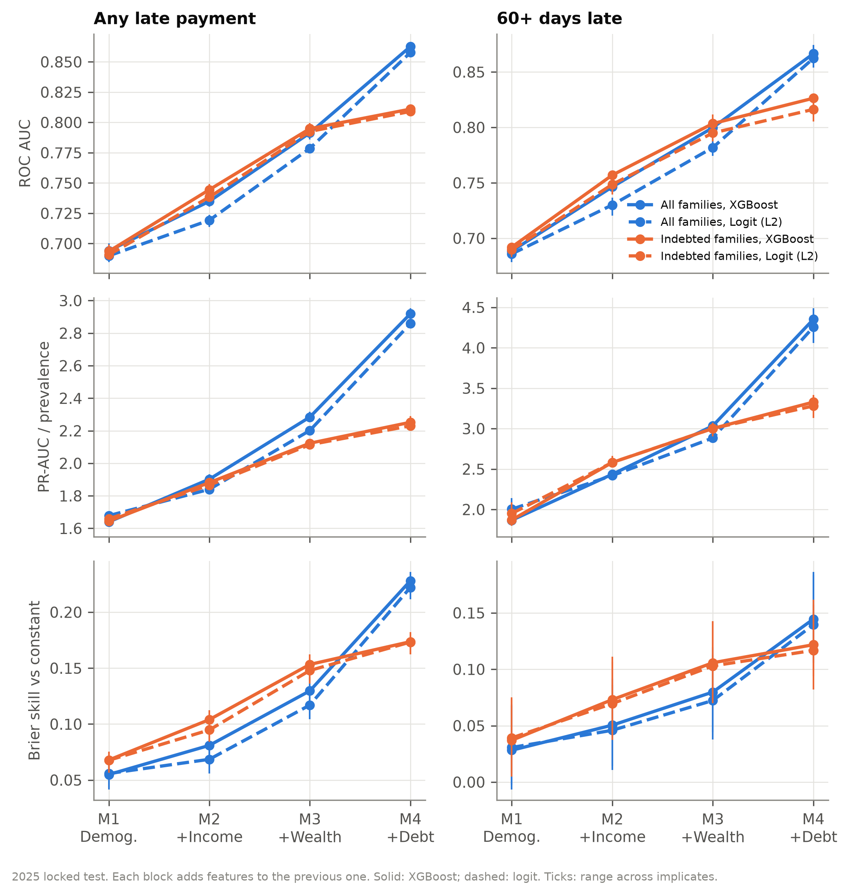
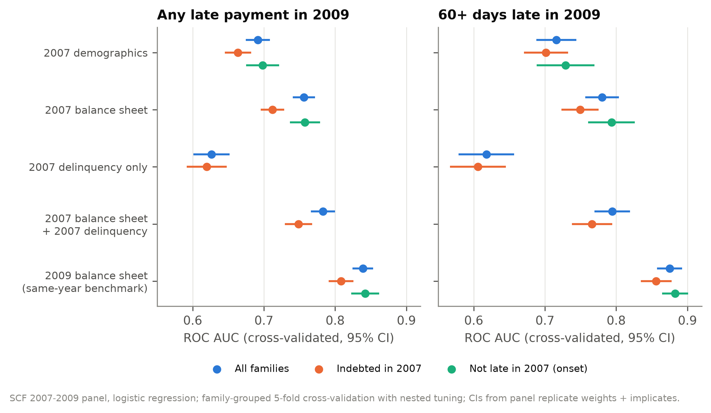

#Classifying and Predicting Household Delinquency: A Machine Learning Approach

Which U.S. households fall behind on their debts, and can it be seen coming? This project trains survey-weighted
machine-learning models on Federal Reserve **Survey of Consumer Finances** microdata (2007–2025) to identify
households that missed loan payments, and to predict who will miss them two years later.

🧮 **Try it:** [estimate your own risk of falling behind](https://stefansongecon.github.io/scf-distress-ml/) — an interactive calculator
running the two-years-ahead predicting model in your browser

📄 **Paper:** [`docs/scf_delinquency_report.md`](docs/scf_delinquency_report.md)

---

## Key takeaways

1. **The balance sheet identifies delinquent households, and liquidity carries the signal.**
   Out of sample on the 2025 survey, AUC rises from **0.69** with demographics alone to **0.86** with the full
   balance sheet. Liquid assets are the single most informative variable.

2. **Among borrowers, how much you hold matters more than how much you owe.**
   Once liquidity and wealth are known, detailed debt and debt-service measures add only about **0.02 AUC**.

3. **Simple models are enough.** Regularized logistic regression matches XGBoost in every specification; there is
   no hidden nonlinearity to find.

4. **Rankings travel across time; levels don't.** Models trained on 2010–2019 rank 2025 households accurately, but
   delinquency jumped from **12% to 20%** between 2019 and 2025 and the models under-predict it. Risk scores need
   recalibration to current conditions.

5. **About half of the signal is forward-looking.** In the 2007–2009 panel, 2007 balance sheets predict delinquency
   during the financial crisis two years later (**AUC 0.78** with past delinquency) versus 0.84 for same-year data.
   They also predict new delinquency: **60%** of households late in 2009 had been current in 2007, and their onset
   is predictable from 2007 finances (AUC 0.76).



*Performance on the locked 2025 test as information is added: demographics → income → wealth and liquidity → debt
and housing. Blue: all families; orange: families with debt.*



*Predicting 2009 delinquency from information observed in 2007, compared with same-year information.*

---

## Use the model

### Interactive calculator

**[stefansongecon.github.io/scf-distress-ml](https://stefansongecon.github.io/scf-distress-ml/)** — answer up to eight
questions (age, education, cash savings, total debt, student loans, home value, an unusually low income year, a
recent missed payment) and get your probability of a late or missed loan payment about two years ahead, your
percentile among U.S. households, and what drives your estimate. Skipped questions use the U.S. average. The model
is trained on the 2007–2009 SCF panel (2007 answers → 2009 delinquency, cross-validated AUC **0.78**, the same as the
48-feature research model) and anchored to 2025 delinquency levels; everything runs client-side.

### Seven-question risk score (Python)

The research models are distilled into a deployable score that needs only seven inputs (age, liquid assets,
total debt, home value, student loans, education, and whether income is unusually low) and keeps essentially all
of the accuracy (**AUC 0.85** on the 2025 survey vs 0.86 for the full 46-feature model). Missing inputs are filled
with 2025 sample means.

```bash
python -m scf_distress.score --age 29 --liquid-assets 300 --total-debt 38000 --education-debt 30000 \
    --income-unusually-low yes --education some_college --home-value 0
```

```text
Any late or missed loan payment (past 12 months):
  probability 74.1%  (U.S. average 19.6%)
  percentile  100  ->  Very high risk
Main drivers vs. an average household:
  liquid_assets          raises risk (+1.10 log-odds)
  total_debt             raises risk (+0.65 log-odds)
  income_unusually_low   raises risk (+0.41 log-odds)
```

Model card, performance and Python API: [`docs/risk_score.md`](docs/risk_score.md).

---

## What's under the hood

- **The Fed's own variable definitions, reproduced exactly.** A small SAS interpreter runs the Federal Reserve's
  summary-variable programs in Python; it matches the Fed's published data on all 350 variables, for every
  household, in all five survey waves.
- **Survey-correct machine learning.** One model per multiple-imputation implicate, survey weights in training and
  evaluation, and confidence intervals from the SCF's 999 replicate weights.
- **An honest test.** Models were tuned on 2010–2019 with forward-chaining validation, the specification was
  committed, and the 2025 survey was scored once.
- **Genuine prediction.** Family-grouped, nested cross-validation on the 2007–2009 panel, where every predictor
  precedes the outcome.

| | Classification | Prediction |
|---|---|---|
| Data | SCF 2010, 2013, 2016, 2019, 2025 (28,882 families) | SCF 2007–2009 panel (3,857 families) |
| Question | who has recently fallen behind? | who will fall behind two years later? |
| Evaluation | train 2010–2019, test once on 2025 | nested family-grouped cross-validation |
| Best AUC | 0.86 | 0.78 (0.84 same-year benchmark) |

## Repository

```text
docs/scf_delinquency_report.md   the paper
docs/writeup.md                  short project summary
docs/risk_score.md               deployable risk scores: model card and usage
docs/index.html                  interactive calculator (GitHub Pages)
models/distress_score_v1.json    current-distress score (7 inputs)
models/predictive_score_v1.json  two-years-ahead score used by the calculator (8 inputs)
results/report.md                detailed cross-sectional results
results/panel/report.md          detailed panel results
results/figures/, results/panel/figures/   all figures
results/tables/, results/panel/tables/     all result tables
src/scf_distress/                pipeline code
  sasport.py                       SAS interpreter for the Fed programs
  prepare.py, panel.py             building SCF variables from raw data
  features.py                      labels, samples, feature blocks
  models.py, pipeline.py           estimation, tuning, locked test
  evaluate.py, variance.py         weighted metrics, replicate-weight inference
  explain.py, figures.py           importance, SHAP, subgroups, figures
  panel_model.py, panel_analysis.py  two-years-ahead prediction
  deploy.py, score.py              parsimonious risk score and scoring API/CLI
  predict_deploy.py, webapp.py     two-years-ahead model and calculator page builder
tests/                           62 unit tests
```

## Reproduce

The SCF data are public. Download the full public Stata files from the
[Federal Reserve](https://www.federalreserve.gov/econres/scfindex.htm) into `data/raw/`
(`p10i6.dta`, `p13i6.dta`, `p16i6.dta`, `p19i6.dta`, `p25i6.dta`, `p09pi6.dta`), and the summary extracts and
replicate weights into `data/external/` as listed in `data/PROVENANCE.json`. Then:

```bash
python3 -m venv .venv && .venv/bin/python -m pip install -e '.[ml,explain,dev]' pyarrow
.venv/bin/python -m scf_distress.pipeline --config config.yaml --build                              # SCF variables
.venv/bin/python -m scf_distress.pipeline --config config.yaml --run --explain --variance --figures  # classification
.venv/bin/python -m scf_distress.pipeline --config config.yaml --panel                              # prediction
.venv/bin/python -m scf_distress.pipeline --config config.yaml --deploy                             # risk score
.venv/bin/python -m scf_distress.pipeline --config config.yaml --web                                # calculator
.venv/bin/python -m pytest -q
```

The full pipeline runs in under ten minutes on a laptop. Python 3.12 · pandas · scikit-learn · XGBoost · matplotlib.
