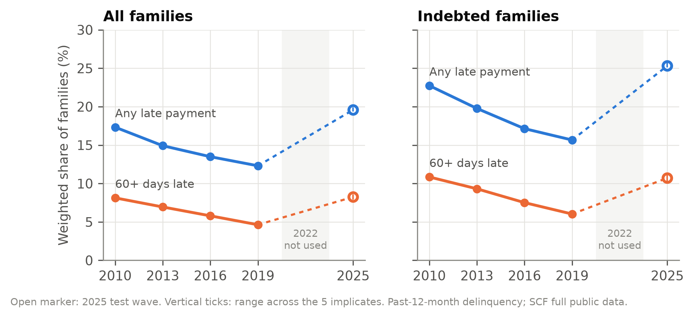
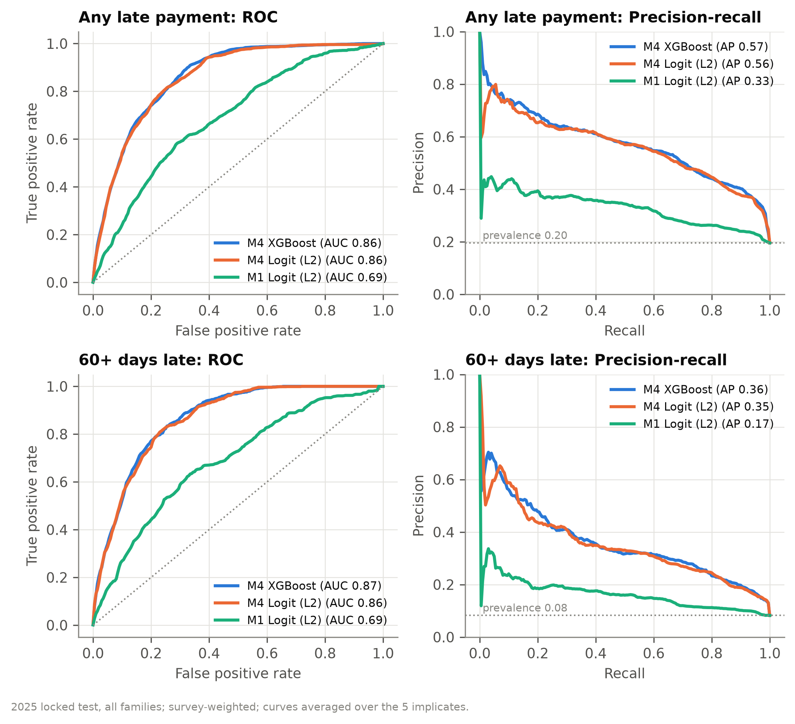
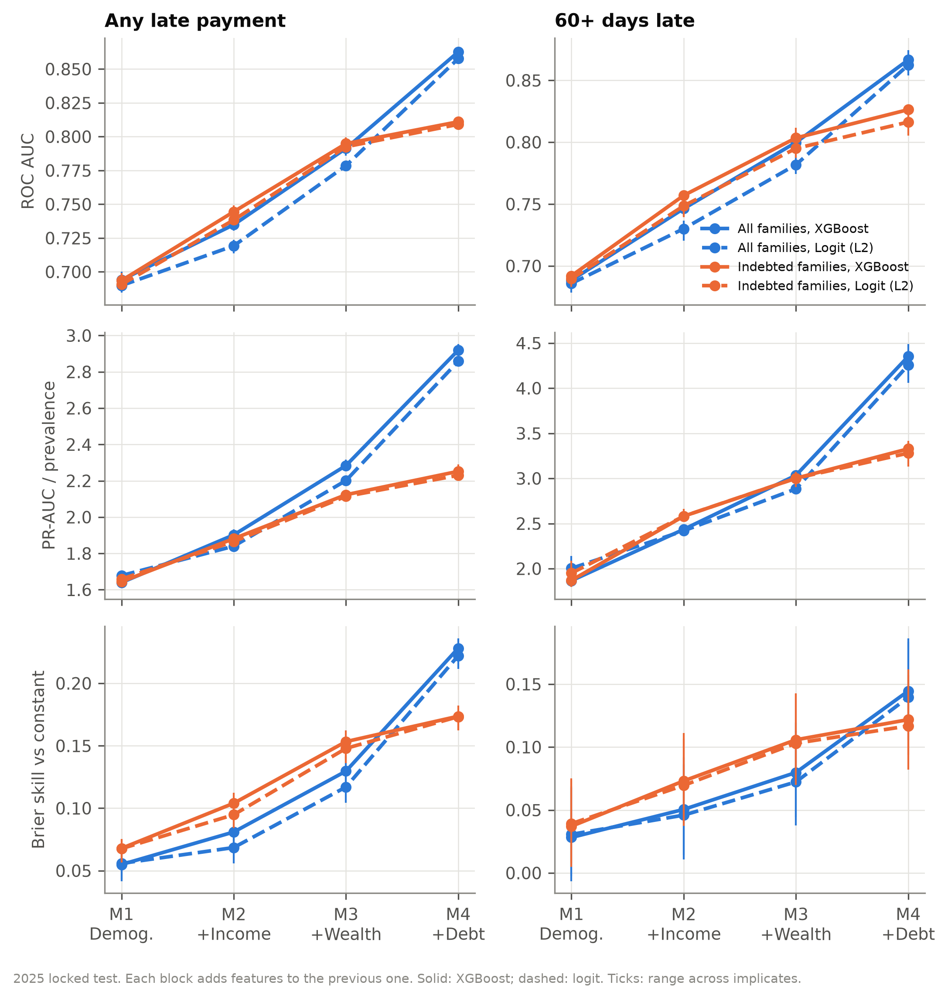
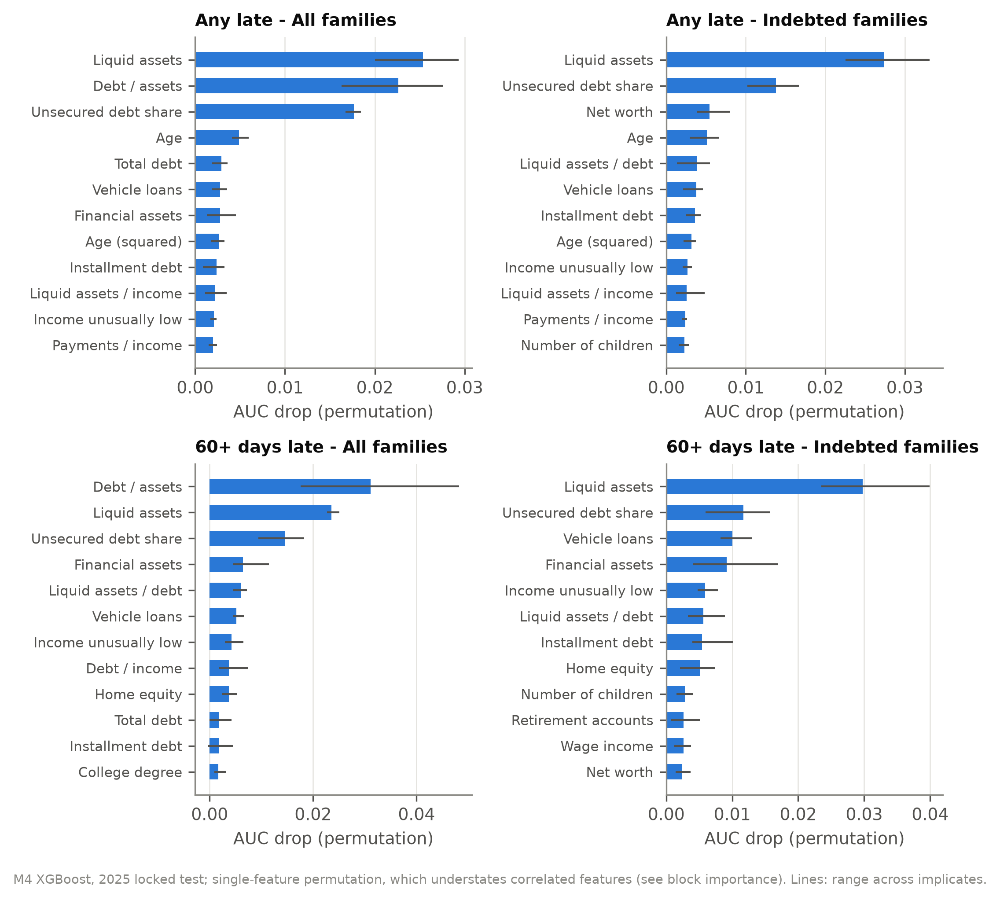
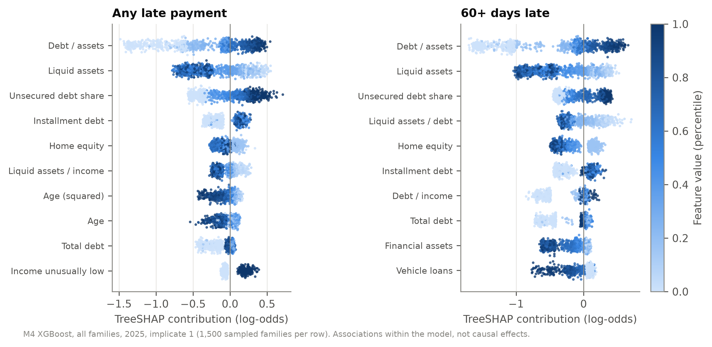
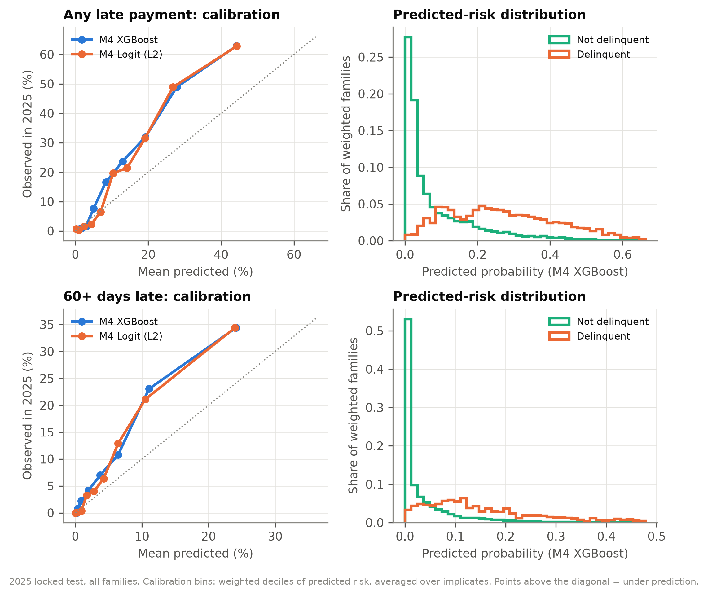
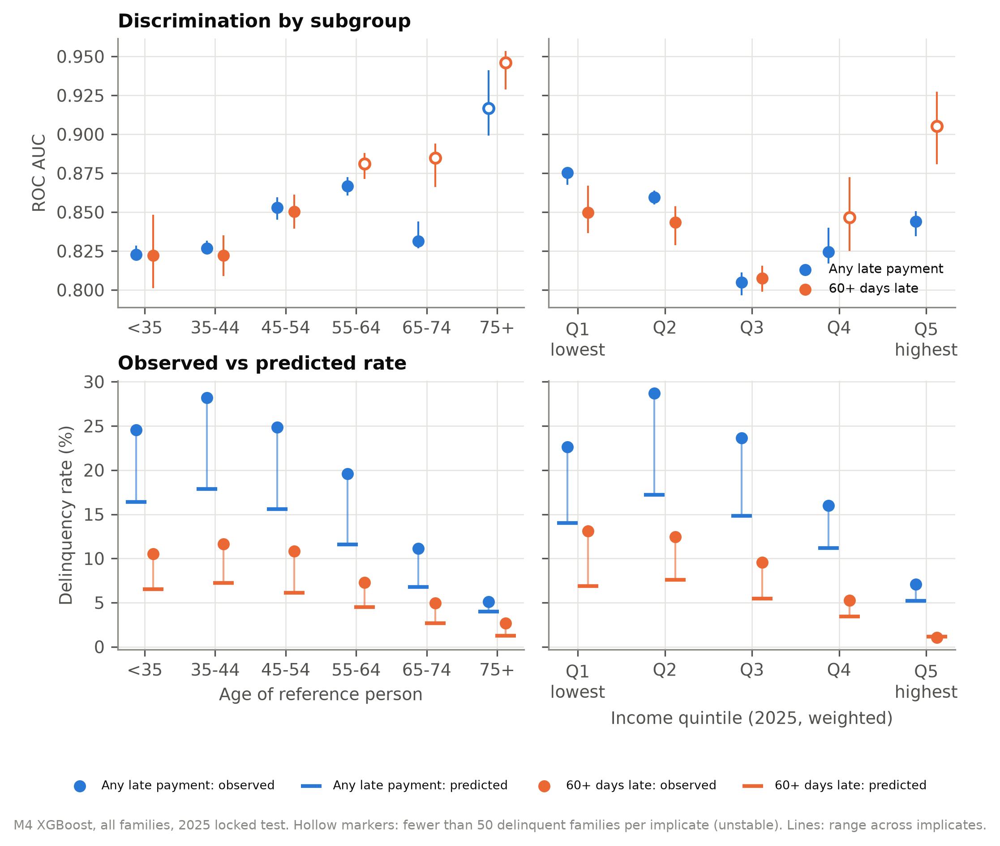
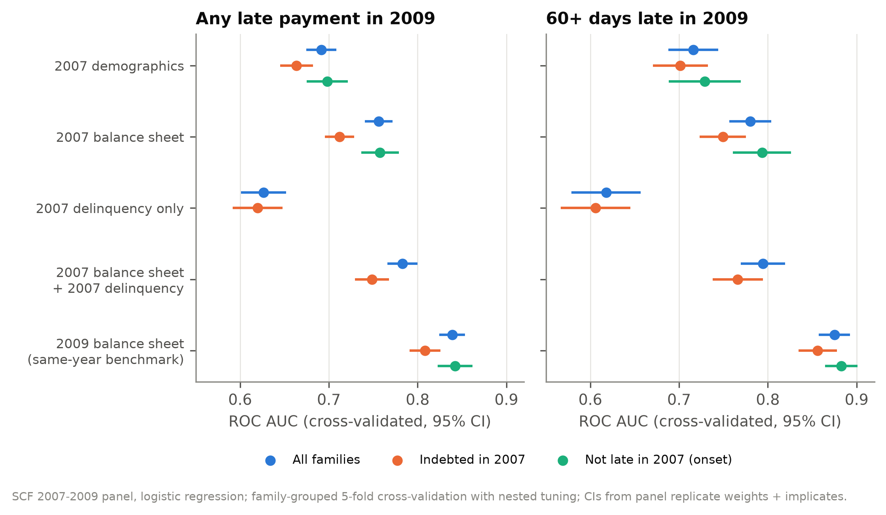
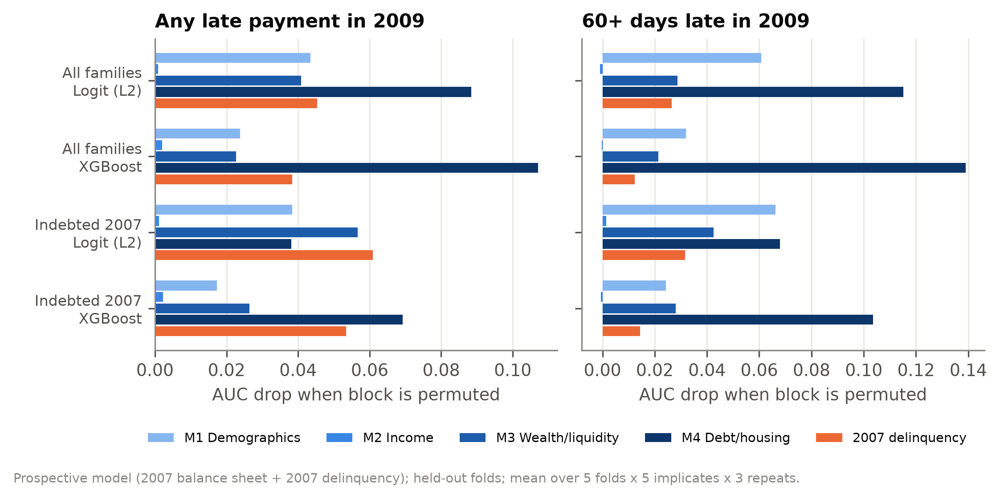

# Household Financial Distress in the Survey of Consumer Finances: Classification and Prediction with Machine Learning

**Data:** Federal Reserve Survey of Consumer Finances (SCF), full public data — cross-sections 2010, 2013, 2016,
2019, 2025 and the 2007–2009 panel
**Methods:** survey-weighted L2 logistic regression and XGBoost, fit per multiple-imputation implicate; locked
out-of-time test; nested cross-validation; replicate-weight confidence intervals
**Code:** `src/scf_distress/` (Python); all numbers in this document are computed by that code

---

## Abstract

Which households fall behind on their debts, and can it be seen coming? This project answers two related
questions with SCF microdata.

**Part I — Classification (cross-sections, 2010–2025).** Using a household's demographics, income and balance
sheet at the interview, models identify families that were late on a loan payment in the previous twelve months.
Trained on 2010–2019 and tested once on the newly released 2025 survey, the full model reaches ROC AUC 0.86
(95% CI 0.85–0.87), against 0.69 for demographics alone. Liquid assets are the most informative variable; among
borrowers, detailed debt measures add little beyond liquidity and wealth; logistic regression matches gradient
boosting. Rankings carry over to 2025, but levels do not: delinquency rose from 12% (2019) to 20% (2025), and
models trained on earlier years under-predict it.

**Part II — Prediction (2007–2009 panel).** Using only information from the 2007 interview, models predict
delinquency reported two years later in 2009, during the financial crisis. The 2007 balance sheet predicts 2009
delinquency with AUC 0.76 (0.78 with 2007 delinquency added), against 0.69 for demographics and 0.84 for the same
families' 2009 balance sheet. Balance sheets are forward-looking, including for families who were current in
2007, but part of the cross-sectional accuracy (about 0.08–0.10 AUC) is contemporaneous.

---

## 1. Questions and contributions

| | Part I: Classification | Part II: Prediction |
|---|---|---|
| Question | Which households *have recently been* delinquent, given their current finances? | Which households *will be* delinquent, given finances two years earlier? |
| Data | 5 cross-sections, 28,882 families | 2007–2009 panel, 3,857 families |
| Timing | predictors at interview; outcome in previous 12 months | predictors in 2007; outcome window mid-2008 to 2009 |
| Validation | locked out-of-time test on 2025 | family-grouped nested cross-validation |
| Use | describe and measure distress; transportability over time | forecasting; separating forward-looking from contemporaneous signal |

Contributions:
1. A Python port of the Federal Reserve's own SAS variable-construction programs, matching the Fed's published
   extracts exactly for the cross-sections and with every difference explained for the panel.
2. A survey-correct ML workflow: one model per implicate, survey weights in fitting and evaluation, design-based
   confidence intervals from the SCF replicate weights, and paired tests between models.
3. Evidence that liquidity, not debt detail, is the core signal, and a measurement of how much of it is
   forward-looking.

---

## 2. Data

### 2.1 Sources

| Data | Content | Use |
|---|---|---|
| SCF full public data `p10i6`, `p13i6`, `p16i6`, `p19i6`, `p25i6` | 4,360–6,482 families per wave, 5 implicates each, raw questionnaire variables | Part I |
| SCF 2007–2009 panel `p09pi6` | 3,857 families interviewed in 2007 (`X` variables) and re-interviewed in 2009 (`P` variables) | Part II |
| Fed SAS programs `bulletin.macro.txt`, `fedstables.macro.txt` | official definitions of income, assets, debts, payment ratios | variable construction |
| Fed summary extracts `scfp<year>`, `rscfp2009panel` | the Fed's own computed variables | validation only, never model inputs |
| Fed replicate weights `scf<year>rw1`, `scf2009prw1` | 999 replicate weights per family | confidence intervals |

2022 is excluded by design. Checksums and URLs for every file: `data/PROVENANCE.json`.

### 2.2 Constructing variables: porting the Fed's SAS programs

The SCF's standard variables (income, net worth, debt, payment-to-income, …) are produced by the Fed's SAS
programs from raw answers. Rather than re-deriving them by hand, a small SAS interpreter (`sasport.py`) runs the
Fed's own code in Python: it resolves the macro layer for each year (`%IF`/`%ELSE`, `%LET`, `%EVAL`, the payment
frequency helper `%MCONV`, and in the panel program the pointers that switch between 2007 `X` and 2009 `P`
variables), parses the DATA step, and executes it vectorized with SAS missing-value and comparison rules.

| Validation against Fed extract | Result |
|---|---|
| Cross-sections 2010–2025 | **All 350 variables match exactly for every family-implicate in all five waves** |
| Panel 2007 | 173 of 188 match exactly |
| Panel 2009 | 181 of 188 match exactly |

All panel differences are explained: one family's stock holdings differ in both years because the 2012 extract
predates the 2014 data release used here (the build follows the raw values), and the extract's `MSAVING07` is in
nominal dollars (ratio exactly the CPI factor 3171/3062; liquid assets, which contain it, match). The comparison
caught one translation bug during development (an assignment `CALL=…` mistaken for a SAS `CALL` routine).

Dollar values: 2025 dollars in Part I, 2009 dollars in Part II (Fed CPI-U-RS factors).

### 2.3 Outcomes

- `LATE` — any loan payment late or missed in the past 12 months (`X3004 = 5`).
- `LATE60` — any payment 60+ days late in the past 12 months (`X3005 = 1`; asked only if `LATE`).

Families with no loan payments due are not asked and are coded 0. One 2016 family with `LATE60 = 1` but no
payments due was set to 0 so that `LATE60 ≤ LATE` always holds.

### 2.4 Samples

| Sample | Part I | Part II |
|---|---|---|
| All families | primary | primary |
| Indebted | debt at interview (`HDEBT = 1`) | debt in 2007 |
| Robustness / extra | payments due in past year (`X3004 ≠ 0`) | onset: families not late in 2007 |

The indebted sample matters because families without loan payments cannot be late, so in the full population
debt variables partly separate the outcome mechanically.

### 2.5 Features

46 whitelisted predictors in four nested blocks, identical in both parts:

| Block | Adds |
|---|---|
| M1 Demographics (11) | age, age², married, children, education class, family structure |
| M2 + Income (18) | income, wage income, normal income, zero/negative income flags, income unusually high/low |
| M3 + Wealth/liquidity (24) | total, financial, liquid and retirement assets; no liquid assets; liquid assets / income |
| M4 + Debt/housing (46) | net worth and negative net worth, has debt, total/credit-card/mortgage/installment/education/vehicle debt, monthly payments, payments / income (total, consumer, revolving), debt / income, debt / assets, liquid assets / debt, debt shares, homeownership, home value and equity |

Dollar amounts use `asinh` (keeping negative net worth negative); constructed ratios floor denominators at
$1,000; all transforms are fixed formulas, so nothing is fitted on test data. Net worth is placed in M4 because,
with total assets in M3, it would reveal total debt. Part II adds 2007 delinquency (`LATE`, `LATE60` in 2007) as
lagged features.

### 2.6 Leakage controls

- **Banned from all models:** outcome sources (`LATE`, `LATE60`, `X3004`, `X3005`; in Part II the 2009 values),
  family and implicate IDs, weights, survey year, and realized hardship events (bankruptcy, foreclosure, payday
  loans, credit denial, emergency borrowing).
- **Splits:** the five implicates of a family always stay together; test data never inform features, transforms,
  thresholds or hyperparameters.
- **Timing (Part II):** 2007 interviews ran May 2007–March 2008 and 2009 interviews July 2009–January 2010, so
  the 2007 reference period ends before the 2009 one begins; 2007 delinquency is legitimately prior information.
- **Simultaneity (Part I):** some cross-sectional features (low liquidity, card balances, unusually low income)
  can be consequences of the same hardship. This is not leakage for a classification task, since all of it is
  observed at the interview, but it is why Part I is not presented as forecasting, and Part II measures how large
  the contemporaneous component is (§6).

---

# Part I — Classification: who has recently fallen behind? (2010–2025)

## 3. Design

### 3.1 Out-of-time validation and tuning

| Split | Train | Evaluate |
|---|---|---|
| Tuning fold 1 | 2010, 2013 | 2016 |
| Tuning fold 2 | 2010, 2013, 2016 | 2019 |
| Final model | 2010–2019 | **2025, scored once** |

- **Models:** constant (weighted prevalence), L2 logistic regression with weighted standardization, XGBoost.
- **Implicates:** each model is fit separately on each implicate; results are mean and range across implicates.
- **Weights:** survey weights in fitting (each training wave rescaled to equal total weight) and in all metrics.
- **Tuning:** logit `C` ∈ {0.001, …, 100}; XGBoost depth ∈ {2, 3, 4, 6}, learning rate 0.05, early stopping on the
  validation wave. Selection by lowest validation log loss averaged over folds and implicates. Final tree count =
  mean early-stopping iteration. Selected for M4: logit `C = 0.1` throughout; XGBoost depth 3–4, 126–185 trees.
- **Lock:** code and configuration were committed (config hash recorded) before any model saw 2025.
- **Tuning sensitivity:** the surface is flat (validation log loss 0.3062–0.3078 across XGBoost depths for the
  main model), so results do not hinge on tuning.

### 3.2 Metrics and uncertainty

ROC AUC; PR-AUC against prevalence; Brier score; log loss; recall and lift in the top 10% of predicted risk;
calibration intercept, slope and binned plots. Confidence intervals follow the Fed codebook: metrics recomputed
under 999 replicate weights (sampling variance, implicate 1) combined with the variance across implicates,
`SE = √(6/5·Var_imp + Var_samp)`; predictions are held fixed, so intervals reflect uncertainty in the 2025
evaluation. Model comparisons are paired (same replicate weights for both).

## 4. Results

### 4.1 Delinquency over time

| Wave | Families | Any late (all) | 60+ days (all) | Any late (indebted) |
|---|---|---|---|---|
| 2010 | 6,482 | 17.3% | 8.1% | 22.7% |
| 2013 | 6,015 | 14.9% | 6.9% | 19.8% |
| 2016 | 6,248 | 13.5% | 5.8% | 17.1% |
| 2019 | 5,777 | 12.3% | 4.6% | 15.7% |
| 2025 | 4,360 | **19.6%** | **8.2%** | **25.3%** |

Standard errors are 0.2–0.7 percentage points; the 2019–2025 rise is about 10 standard errors.



### 4.2 Locked 2025 test

| Features | Model | Any late: AUC (95% CI) | PR-AUC | 60+ days: AUC (95% CI) | PR-AUC |
|---|---|---|---|---|---|
| — | Constant | 0.500 | 0.196 | 0.500 | 0.082 |
| M1 demographics | Logit | 0.690 (0.670–0.709) | 0.33 | 0.686 (0.657–0.715) | 0.17 |
| M2 + income | XGBoost | 0.735 | 0.37 | 0.746 | 0.20 |
| M3 + wealth | XGBoost | 0.791 | 0.45 | 0.800 | 0.25 |
| M4 + debt/housing | Logit | 0.858 (0.846–0.869) | 0.56 | 0.862 (0.843–0.882) | 0.35 |
| M4 + debt/housing | XGBoost | **0.863** (0.851–0.874) | **0.57** | **0.867** (0.848–0.885) | **0.36** |

Indebted families, M4: AUC 0.809–0.811 (any late) and 0.816–0.826 (60+ days). The full model's top 10% of
predicted risk contains 32% of late payers (lift 3.2) and 42% of those 60+ days late (lift 4.2).



### 4.3 What each information block adds



- Every step M1→M2→M3→M4 improves AUC significantly in paired tests, in both samples and for both outcomes.
- **All families:** the debt/housing block adds the most (+0.07–0.08 AUC), partly because families without debt
  cannot be late.
- **Indebted families:** wealth and liquidity carry most of the signal; adding debt detail raises AUC by only about
  0.02 (e.g. +0.016, CI 0.008–0.025), and for 60+ days late the PR-AUC gain is not significant.
- **Logit vs XGBoost:** no significant difference at M4 in any setting (largest gap 0.010 AUC).

### 4.4 What the model learned



- **Liquid assets** are the most informative single feature in nearly every model; low liquidity goes with higher
  predicted delinquency.
- **Debt-to-assets** and the **unsecured share of debt** come next among all families (debt-to-assets also encodes
  having any debt).
- **Income unusually low**, age, vehicle and installment debt, and home equity contribute less.
- Block-level permutation is the more reliable summary because debt totals, ratios and shares are correlated.



### 4.5 Calibration and the 2025 shift



Every model under-predicts 2025 delinquency: calibration-in-the-large is +0.36 to +0.71 on the log-odds scale
(e.g. +0.67, CI 0.60–0.75), with every interval above zero; in the riskiest decile about 63% were late versus 44%
predicted. In the backtests the sign was reversed (over-prediction), because delinquency was falling until 2019.
Survey year is deliberately not a predictor, so the reversal cannot be anticipated. Ranking, by contrast, is
stable and even sharper in 2025 (AUC 0.86 versus 0.81–0.82 in the backtests).

### 4.6 Subgroups



Discrimination is good in every age and income group (AUC 0.80–0.95; cells with fewer than 50 delinquent
families flagged as unstable). Under-prediction is concentrated in households under 55 and in the bottom three
income quintiles (observed 23–29% versus predicted 14–18% for any late payment).

### 4.7 Robustness

| Check | Result |
|---|---|
| Backtests (predicting 2016, 2019) | same ordering of blocks and models |
| Payments-due sample instead of debt at interview | AUC within 0.01 |
| Buy-now-pay-later debt (in Fed totals only from 2025) removed | AUC changes < 0.004; does not explain the higher 2025 AUC |
| Stability across implicates | ±0.005–0.01 AUC |
| Reproducibility | refit models reproduce saved predictions exactly |

---

# Part II — Prediction: who will fall behind? (2007–2009 panel)

## 5. Design

### 5.1 Why the panel

Part I measures predictors and outcome at the same interview. The SCF 2007–2009 panel re-interviewed 2007
families in 2009, so 2007 information can be used to predict delinquency during the financial crisis. Every
predictor precedes the outcome period (§2.6).

### 5.2 Setup

| Element | Choice |
|---|---|
| Outcome | `LATE`, `LATE60` reported in 2009 (17.8% and 7.8%, weighted; 550 and 246 families per implicate) |
| Prospective feature sets | 2007 blocks M1–M4; 2007 delinquency only; 2007 M4 + 2007 delinquency |
| Benchmark | 2009 M4 balance sheet for the 2009 outcome (same families, contemporaneous) |
| Samples | all families; indebted in 2007; onset (not late in 2007) |
| Weights | 2009 panel weight (nonresponse-adjusted; about 113 million families) |
| Validation | one panel and no later wave, so **family-grouped 5-fold cross-validation**; identical folds for every implicate, feature set and model (paired comparisons); one out-of-fold prediction per family and implicate |
| Tuning | nested: 3 inner folds within each training fold; logit `C` ∈ {0.001, …, 100}, XGBoost depth ∈ {2, 3, 4} with early stopping; selection by inner log loss over folds and implicates (chosen: mostly `C` = 0.01–0.1 and depth 2) |
| Uncertainty | panel replicate weights + implicates, as in Part I |

## 6. Results

### 6.1 Prospective accuracy



**ROC AUC (logit, 95% CI):**

| Sample | Information used | Any late in 2009 | 60+ days late in 2009 |
|---|---|---|---|
| All families | 2007 demographics | 0.691 (0.674–0.708) | 0.716 (0.688–0.744) |
| | 2007 balance sheet | 0.756 (0.741–0.772) | 0.780 (0.757–0.804) |
| | 2007 delinquency only | 0.626 (0.601–0.652) | 0.618 (0.579–0.657) |
| | 2007 balance sheet + 2007 delinquency | **0.783** (0.766–0.800) | **0.795** (0.770–0.820) |
| | 2009 balance sheet (benchmark) | 0.839 (0.825–0.853) | 0.875 (0.858–0.892) |
| Indebted in 2007 | 2007 balance sheet | 0.712 (0.695–0.729) | 0.749 (0.723–0.775) |
| | + 2007 delinquency | 0.749 (0.730–0.768) | 0.766 (0.738–0.794) |
| Not late in 2007 (onset) | 2007 balance sheet | 0.758 (0.737–0.779) | 0.794 (0.761–0.826) |

Best prospective model, all families: PR-AUC 0.40 (prevalence 0.178) and 0.21 (prevalence 0.078); the top 10% of
predicted risk contains 26% and 30% of delinquent families (lift 2.6 and 3.0). Calibration-in-the-large is within
±0.04 of zero for every model (no time shift inside one period).

### 6.2 Paired comparisons (all families)

| Comparison | Any late | 60+ days late |
|---|---|---|
| 2007 balance sheet − 2007 demographics | +0.065 | +0.064 |
| debt/housing block (M4 − M3), 2007 | +0.026 | +0.041 |
| adding 2007 delinquency to the 2007 balance sheet | +0.027 | +0.014 (XGBoost +0.007, n.s.) |
| 2009 vs 2007 balance sheet (contemporaneous premium) | +0.083 | +0.095 |
| XGBoost − logit | 0.000 (n.s.) | +0.006 (n.s.) |

All intervals exclude zero unless marked n.s. Among families indebted in 2007, debt detail again adds little to
wealth and liquidity for any late payment (+0.008, n.s., logit).

### 6.3 Persistence and onset

45% of families late in 2007 were late again in 2009, versus 13% of families who were current (3.5 times the
rate). Yet about 60% of 2009 delinquency came from families current in 2007, and their onset is predictable from
2007 finances (AUC 0.76–0.79). 2007 delinquency alone is a weak predictor (AUC 0.62–0.63).

### 6.4 What drives prospective predictions



The debt/housing and wealth/liquidity blocks carry most of the signal; demographics matter more than in the
cross-section; the income block adds essentially nothing once wealth is known. 2007 delinquency is the single most
important feature in the any-late models (AUC drop 0.04–0.06), followed in the logit by liquid assets, college
education and age.

---

# Part III — Synthesis

## 7. What the two exercises show together

| | Same-year information | Two years earlier |
|---|---|---|
| Balance sheet vs demographics only | +0.15–0.18 AUC (Part I; panel 2009 benchmark) | +0.065 AUC (panel 2007) |
| Best AUC | 0.86 (2025 test); 0.84–0.88 (panel 2009) | 0.78–0.80 (panel 2007 + past delinquency) |
| Calibration | shifts across eras (2025 under-predicted) | stable within one period |

1. **Liquidity is the common core.** In both designs, wealth and liquidity carry most of the information among
   borrowers, and detailed debt measures add relatively little.
2. **About half of the balance-sheet signal is forward-looking.** Measured two years earlier, the balance sheet
   keeps less than half of its same-year advantage over demographics. The cross-sectional association is not only
   reverse causality, but a substantial part of it is contemporaneous: finances partly reflect the hardship that
   produces late payments.
3. **Rankings travel; levels do not.** Across 15 years the same households rank as high-risk, but aggregate
   delinquency moves with conditions that balance sheets do not capture. Predicted probabilities need
   recalibration before being read as rates in a new period.
4. **Simple models suffice.** In neither design does gradient boosting beat a well-specified logistic regression.

**Why both parts are needed.** The classification exercise provides scale (29,000 families), recency, a true
out-of-time test, evidence of stability over 15 years, the distribution-shift result, and the same-year benchmark
that gives the prediction results meaning. The prediction exercise answers the main objection to the
classification, namely that predictors and outcome are measured at the same time, and quantifies how much of the
signal is usable for forecasting.

## 8. Limitations

- **Part I is retrospective classification**, not a forecast; low liquidity may be a consequence of distress.
- **Part II covers one panel in one crisis period** and is validated by cross-validation, not on a later panel.
  About 11% of eligible 2007 families did not complete the 2009 interview (the Fed's nonresponse-adjusted weights
  are used).
- **Confidence intervals** cover sampling and imputation uncertainty of the evaluation with predictions held
  fixed, not variability from re-drawing the training data; subgroup and backtest results report implicate ranges.
- **Not causal:** importance measures and SHAP values describe models, not interventions.
- **Not yet run:** raw-population-weight and recent-waves-only robustness, recalibration on historical data, and a
  model with behavioural variables (saving habits, risk attitude, financial literacy).

## 9. Reproducibility

```bash
python3 -m venv .venv && .venv/bin/python -m pip install -e '.[ml,explain,dev]' pyarrow
.venv/bin/python -m scf_distress.pipeline --config config.yaml --build                          # Fed variables
.venv/bin/python -m scf_distress.pipeline --config config.yaml --run --explain --variance --figures   # Part I
.venv/bin/python -m scf_distress.pipeline --config config.yaml --panel                          # Part II
.venv/bin/python -m pytest -q                                                                    # 52 tests
```

Run time on a laptop: about 3 minutes for Part I and 3.5 minutes for Part II. Python 3.12, pandas, NumPy,
scikit-learn, XGBoost, matplotlib; fixed seed. Tests cover the SAS semantics and Fed-extract match, ID and implicate
handling, temporal and family-grouped splits, leakage whitelists, weight scaling, weighted metrics and the
replicate-weight formula.

| Output | Location |
|---|---|
| Part I detailed report | `results/report.md` |
| Part II detailed report | `results/panel/report.md` |
| Tables | `results/tables/`, `results/panel/tables/` |
| Figures | `results/figures/`, `results/panel/figures/` |
| Fed-extract validation | `results/tables/macro_validation.csv`, `results/tables/panel_macro_validation.csv` |
| Run metadata (versions, hyperparameters, timings) | `results/run_metadata.json`, `results/panel/run_metadata.json` |
