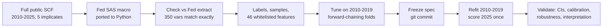
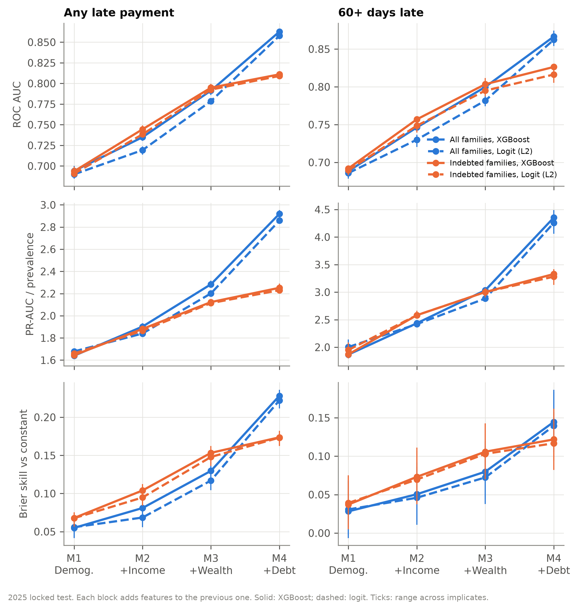
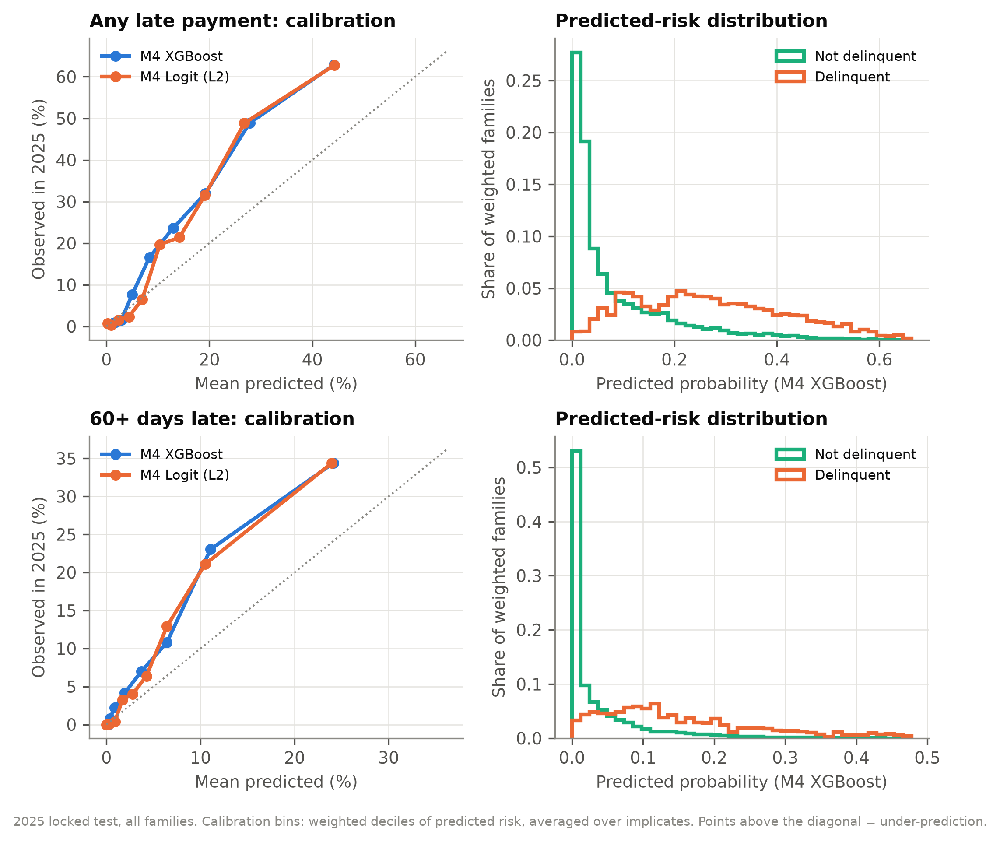
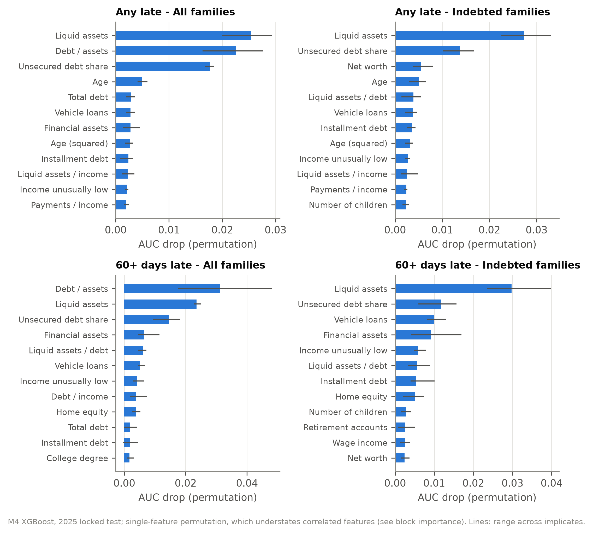

# Who Falls Behind on Debt? Classifying Household Delinquency in the Survey of Consumer Finances

**Question.** How well can a household's demographics, income and balance sheet identify families that missed or
were late on a loan payment in the past year, and do patterns learned on 2010–2019 data hold up in the newly
released 2025 survey?

**Answer in brief.** Balance-sheet information, above all liquid assets, raises out-of-sample ROC AUC from 0.69
(demographics only) to 0.86. A regularized logit is as good as gradient boosting. Models trained on earlier
waves *rank* 2025 households well but under-predict the 2025 *level*, because delinquency jumped from 12% to
20% after a decade of decline.



---

## 1. Data cleaning

**Source.** Federal Reserve *Survey of Consumer Finances* (SCF), full public datasets for 2010, 2013, 2016,
2019 and 2025: 4,360–6,482 families per wave, each stored as **five multiple-imputation implicates**
(144,410 records in total), with survey weights. 2022 is left out by design.

| Step | What was done | Why |
|---|---|---|
| 1. IDs | Family = `YY1`; implicate = `Y1 − 10·YY1`; checked that every family has exactly implicates 1–5 | Five implicates are one household, not five observations |
| 2. Constructed variables | Ported the Fed's own SAS program (`bulletin.macro.txt`, ~3,600 lines) to Python with a small SAS interpreter, then ran it on the raw survey answers | Income, net worth, debt, payment-to-income and so on are defined exactly as in official Fed statistics |
| 3. Validation of step 2 | Compared all 350 resulting variables with the Fed's published summary extract, record by record | **Exact match for every family-implicate in all five waves**; the check caught a translation bug during development |
| 4. Dollars | Converted to 2025 dollars with the Fed's CPI-U-RS factors | Comparable across waves |
| 5. Labels | `LATE` = any payment late in past 12 months (`X3004 = 5`); `LATE60` = 60+ days late (`X3005 = 1`) | Official definitions. One 2016 family violated `LATE60 ≤ LATE`; set to 0 |
| 6. Samples | A: all families. B: families with debt. B2 (robustness): families with payments due in the past year | Families without loan payments cannot be late, so A alone would overstate what debt variables add |
| 7. Features | 46 whitelisted predictors in four nested blocks (below); `asinh` for dollar amounts (keeps negative net worth negative); ratios with floored denominators | Heavy tails without dropping or capping data; fixed transforms cannot leak test information |
| 8. Leakage bans | Excluded outcome sources, IDs, weights, survey year, and realized hardship variables (bankruptcy, foreclosure, payday loans, credit denial) | Keep the model to financial fundamentals |

| Block | Features added |
|---|---|
| **M1** Demographics (11) | age, age², married, children, education, family structure |
| **M2** + Income (18) | income, wage income, normal income, zero/negative income, income unusually high/low |
| **M3** + Wealth/liquidity (24) | total, financial, liquid and retirement assets; no liquid assets; liquid assets / income |
| **M4** + Debt/housing (46) | net worth, debt totals and composition, payments / income, debt / income, debt / assets, home equity, homeownership |

Net worth sits in M4, not M3: together with total assets it would reveal total debt and blur the comparison.

## 2. Model setup

- **Task:** binary classification of `LATE` and `LATE60`, in Samples A and B, for each feature block M1–M4.
- **Models:** constant baseline (weighted prevalence); L2-regularized logistic regression (weighted
  standardization); XGBoost gradient boosting.
- **Multiple imputation:** every model is fit **separately on each of the five implicates**; results are the
  mean and min–max across implicates.
- **Survey weights:** used in fitting (each training wave rescaled to equal total weight) and in every metric.
- **Metrics:** ROC AUC, PR-AUC (compared with prevalence), Brier score, log loss, recall and lift in the top 10% of
  predicted risk, and calibration (intercept, slope, binned plot). Accuracy is not used: the outcome is rare.

## 3. Fine-tuning (validation inside the training years only)

| Split | Train | Validate |
|---|---|---|
| Fold 1 | 2010, 2013 | 2016 |
| Fold 2 | 2010, 2013, 2016 | 2019 |
| Final model | 2010–2019 | — |

- **Grids:** logit `C` ∈ {0.001, 0.01, 0.1, 1, 10, 100}; XGBoost `max_depth` ∈ {2, 3, 4, 6}, learning rate 0.05,
  subsample 0.8, up to 3,000 trees with early stopping (100 rounds) on the validation wave.
- **Selection rule:** lowest validation log loss averaged over both folds and all five implicates (a proper
  scoring rule, so it rewards calibration as well as ranking).
- **Final refit:** chosen settings refit on all of 2010–2019; XGBoost tree count = mean early-stopping
  iteration from the folds.
- **Chosen:** logit `C = 0.1` for every full (M4) model; XGBoost depth 3–4 with 126–185 trees.
- **Sensitivity:** the tuning surface is flat. For any-late / all families / M4, validation log loss varies
  only from 0.3062 to 0.3078 across XGBoost depths and from 0.3129 to 0.3132 for logit `C ≥ 0.01`. Results do
  not hinge on the tuning choices.

## 4. Out-of-sample test

- **Locked protocol:** code and configuration were committed (config hash recorded) **before** 2025 was touched
  by any model; the 2025 wave was then scored once. No feature, threshold, transform or hyperparameter was
  chosen with 2025 data.
- **Test set:** 4,360 families (21,800 records); per implicate 780 families with any late payment and 328 with
  a 60+ day delinquency.

**Results on 2025 (all families; 95% confidence intervals from SCF replicate weights):**

| Features | Model | Any late: AUC | Any late: PR-AUC | 60+ days: AUC | 60+ days: PR-AUC |
|---|---|---|---|---|---|
| — | Constant | 0.500 | 0.196 | 0.500 | 0.082 |
| M1 demographics | Logit | 0.690 (0.670–0.709) | 0.33 | 0.686 (0.657–0.715) | 0.17 |
| M2 + income | XGBoost | 0.735 | 0.37 | 0.746 | 0.20 |
| M3 + wealth | XGBoost | 0.791 | 0.45 | 0.800 | 0.25 |
| M4 + debt/housing | Logit | 0.858 (0.846–0.869) | 0.56 | 0.862 (0.843–0.882) | 0.35 |
| M4 + debt/housing | XGBoost | **0.863** (0.851–0.874) | **0.57** | **0.867** (0.848–0.885) | **0.36** |

The full model's top 10% of predicted risk captures 32% of all households with a late payment (lift 3.2) and 42%
of those 60+ days late (lift 4.2).



## 5. Validating the results

| Check | Result |
|---|---|
| **Confidence intervals** (Fed replicate-weight method: 999 replicates + imputation variance) | AUC standard errors 0.006–0.016. Every block step (M1→M2→M3→M4) improves AUC significantly in paired tests |
| **Logit vs XGBoost** (paired) | No significant difference at M4 in any setting (largest gap 0.010 AUC) |
| **Stability across implicates** | AUC varies by ±0.005–0.01 across the five implicates |
| **Calibration** | Every model under-predicts 2025 (calibration-in-the-large +0.36 to +0.71 log-odds, CIs above zero): see §6 |
| **Backtests** | Same ranking of blocks and models when predicting 2016 and 2019 |
| **Alternative sample** (payments due vs debt at interview) | AUC within 0.01 of Sample B |
| **2025 measurement change** (buy-now-pay-later debt enters Fed totals only in 2025) | Removing it changes AUC by under 0.004 |
| **Subgroups** (age, income quintile) | AUC 0.80–0.95 in every group; small cells flagged |
| **Reproducibility** | Refit models reproduce saved predictions exactly; 47 unit tests (leakage, weights, IDs, metrics, SAS semantics, Fed match) |



## 6. What the model learned

- **Liquidity is the core signal.** Liquid assets are the most informative single feature in nearly every model;
  low liquidity goes with higher predicted delinquency.
- **Among borrowers, debt detail adds little.** In Sample B, wealth and liquidity (M3) carry most of the signal;
  adding debt amounts, composition and payment burdens raises AUC by only about 0.02. In the full population the
  debt block looks larger partly because families without debt cannot be late.
- **Nonlinearity is not needed.** A well-transformed logit matches XGBoost.
- **Ranking transports; levels do not.** Delinquency fell from 17% (2010) to 12% (2019), then rose to 20% (2025).
  Without a time trend the models cannot anticipate the reversal, so predicted probabilities need recalibration
  before being read as 2025 rates. Under-prediction is largest for households under 55 and in the bottom three
  income quintiles.



## 7. Limitations

- **Retrospective, not predictive:** delinquency refers to the 12 months before the interview, while the balance
  sheet is measured at the interview, so low liquidity may partly be a consequence of the same hardship.
  (Planned extension: the SCF 2007–2009 panel, predicting 2009 delinquency from 2007 balance sheets.)
- **Associations, not causal effects:** importance measures and SHAP values describe the model, not interventions.
- **Uncertainty:** confidence intervals cover the 2025 evaluation with fitted models held fixed, not variability
  from the training sample.

## 8. Stack and reproduction

Python 3.12, pandas, NumPy, scikit-learn, XGBoost, matplotlib, pytest. The full pipeline (data build, tuning,
locked test, interpretation, confidence intervals, figures) runs in about three minutes on a laptop.

```bash
.venv/bin/python -m scf_distress.pipeline --config config.yaml --build
.venv/bin/python -m scf_distress.pipeline --config config.yaml --run --explain --variance --figures
.venv/bin/python -m pytest -q
```

Detailed results and every caveat: [`results/report.md`](../results/report.md).
