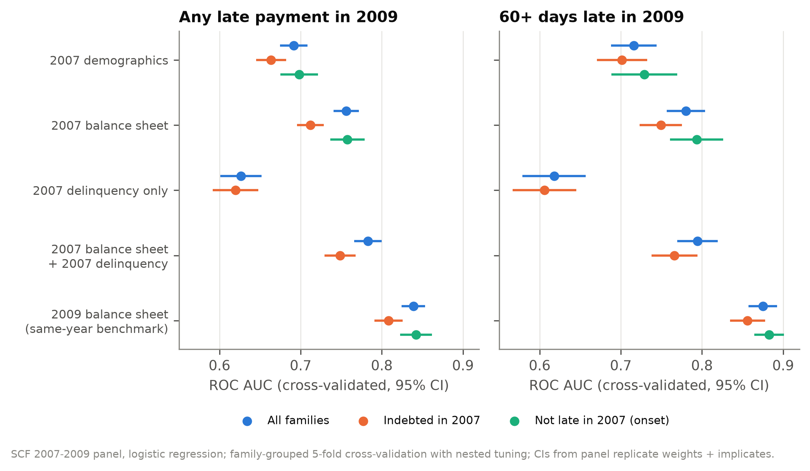
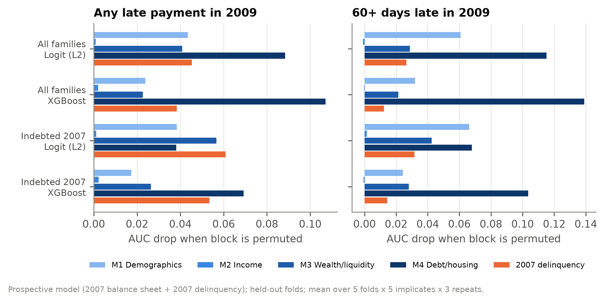

# Prospective Prediction: SCF 2007–2009 Panel

Does a family's **2007** balance sheet predict delinquency in the **2009** re-interview? The 2009 question covers
the 12 months before the interview, i.e. the financial crisis. This turns the cross-sectional classification in
`results/report.md` into genuine prediction: every predictor is measured before the outcome period.

*All numbers are computed by `src/scf_distress/panel_model.py` and `panel_analysis.py` from the full public panel
file `p09pi6.dta` (run 8 Nov 2026). Logistic regression unless noted; 95% confidence intervals from the SCF panel
replicate weights and the five implicates.*

## 1. Summary

- **The 2007 balance sheet predicts 2009 delinquency.** AUC 0.756 (95% CI 0.741–0.772) for any late payment and
  0.780 (0.757–0.804) for 60+ days late, against 0.69–0.72 for 2007 demographics alone. Financial information
  adds about 0.065 AUC (CI excludes zero for both outcomes).
- **Prediction is harder than classification.** The same families' **2009** balance sheet classifies 2009
  delinquency with AUC 0.839 / 0.875: going from same-year to two-years-ahead information costs 0.08–0.10 AUC
  and 30–40% of PR-AUC.
- **Past delinquency helps, but is far from enough.** 45% of families late in 2007 were late again in 2009,
  versus 13% of the rest. Yet 2007 delinquency alone gives only AUC 0.62–0.63; adding it to the 2007 balance sheet
  raises AUC by 0.027 for any late payment (significant) and 0.014 for 60+ days late (significant for the logit,
  not for XGBoost). Best prospective model: AUC 0.783 / 0.795.
- **New delinquency is about as predictable.** Among families *not* late in 2007, the 2007 balance sheet predicts
  2009 onset with AUC 0.758 / 0.794.
- **Logit equals XGBoost** again: no significant difference in any sample.
- **Calibrated within the period.** Calibration-in-the-large is within ±0.04 of zero for every model (it is
  cross-validated within one period, so there is no level shift like the 2025 test).

## 2. Data and validation of the data build

| Item | Detail |
|---|---|
| Panel | 3,857 families interviewed in 2007 and re-interviewed in 2009 (19,285 family-implicate records); 2007 answers are `X` variables, 2009 answers `P` variables |
| Weights | 2009 panel weight `P42001` (Fed `WGT09`) for both years; represents about 113 million families |
| Definitions | Fed panel macro `fedstables.macro.txt`, run with the same Python SAS interpreter as the cross-sections; 2009 dollars |
| Check | Against the Fed panel extract `rscfp2009panel`: **173 of 188 variables match exactly for 2007 and 181 of 188 for 2009**; all differences are explained below |

Differences from the extract:
1. One family (ID 4285, 5 implicates): stock holdings, and therefore financial assets, total assets and net
   worth, differ in both years. The build follows this file's raw values (`X3915` = 810, `P3915` = 970), whereas the
   2012 extract shows 0 and 285,000, so the extract was produced from an earlier data release.
2. `MSAVING07` in the extract is in nominal 2007 dollars (ratio to the build exactly 3171/3062, the CPI factor),
   while liquid assets `LIQ07`, which contain it, match exactly.
3. Naming only: the extract drops underscores (`VEHINST` = `VEH_INST`); percentile categories and two COMBO-step
   ratios (`HIPIR`, `LEVERAGE`) are not ported.

The panel macro does not compute `LATE`, `DEBT2INC` or `LEVRATIO`; they are derived with the Fed's main-macro rules.

**Outcomes.** 2009: any late payment 17.8%, 60+ days late 7.8% (weighted). 2007: 15.5% and 5.9%. Per implicate,
550 families were late in 2009 and 246 were 60+ days late.

## 3. Design

| Element | Choice |
|---|---|
| Outcome | `LATE`, `LATE60` from the 2009 interview |
| Prospective feature sets | 2007 blocks M1–M4 (same 46 features as the cross-section); 2007 delinquency only (`late07`, `late6007`); M4 + 2007 delinquency |
| Benchmark | 2009 M4 features for the 2009 outcome (same families, retrospective) |
| Samples | all families; families with debt in 2007; onset (not late in 2007) |
| Validation | one panel, no later wave: **family-grouped 5-fold cross-validation**, identical folds for every implicate, feature set and model (paired comparisons); every family gets one out-of-fold prediction per implicate |
| Tuning | nested: 3 inner folds within each training fold; logit `C` ∈ {0.001…100}, XGBoost depth ∈ {2, 3, 4} with early stopping; selection by mean inner log loss over inner folds and implicates |
| Models | constant, L2 logit, XGBoost; fit per implicate with survey weights |
| Uncertainty | panel replicate weights (999) + implicates, Fed formula, out-of-fold predictions held fixed |

Run time: 98 s for 78 model settings; confidence intervals and importance 107 s.

## 4. Results



**ROC AUC with 95% CI (logit, cross-validated):**

| Sample | Feature set | Any late payment | 60+ days late |
|---|---|---|---|
| All families | 2007 demographics (M1) | 0.691 (0.674–0.708) | 0.716 (0.688–0.744) |
| | 2007 balance sheet (M4) | 0.756 (0.741–0.772) | 0.780 (0.757–0.804) |
| | 2007 delinquency only | 0.626 (0.601–0.652) | 0.618 (0.579–0.657) |
| | 2007 M4 + 2007 delinquency | **0.783** (0.766–0.800) | **0.795** (0.770–0.820) |
| | 2009 balance sheet (benchmark) | 0.839 (0.825–0.853) | 0.875 (0.858–0.892) |
| Indebted in 2007 | 2007 M4 | 0.712 (0.695–0.729) | 0.749 (0.723–0.775) |
| | 2007 M4 + 2007 delinquency | 0.749 (0.730–0.768) | 0.766 (0.738–0.794) |
| Not late in 2007 (onset) | 2007 M4 | 0.758 (0.737–0.779) | 0.794 (0.761–0.826) |

Best prospective model (all families): PR-AUC 0.40 (any late; prevalence 0.178) and 0.21 (60+ days; prevalence
0.078); the top 10% of predicted risk captures 26% and 30% of delinquent families (lift 2.6 and 3.0). The
same-year benchmark captures 32% and 42%.

**Paired differences (95% CI excludes zero unless noted), all families:**

| Comparison | Any late | 60+ days late |
|---|---|---|
| 2007 M4 − 2007 M1 | +0.065 | +0.064 |
| 2007 M4 − 2007 M3 (debt/housing block) | +0.026 | +0.041 |
| 2007 M4 + delinquency − 2007 M4 | +0.027 | +0.014 (XGBoost +0.007, n.s.) |
| 2009 M4 − 2007 M4 (same year vs two years earlier) | +0.083 | +0.095 |
| XGBoost − logit (2007 M4) | 0.000 (n.s.) | +0.006 (n.s.) |

Among families indebted in 2007, the debt/housing block adds little to wealth and liquidity for any late payment
(+0.008 logit, n.s.; +0.018 XGBoost), mirroring the cross-sectional finding.



**What drives the prospective model** (permutation importance on held-out folds): the debt/housing block (M4)
and wealth/liquidity (M3) carry most of the signal; demographics (M1) matter more than in the cross-section;
the income block adds essentially nothing once wealth is known. 2007 delinquency is the single most important
feature in the any-late models (AUC drop 0.04–0.06), followed in the logit by liquid assets, college education
  and age, and in XGBoost by age, payments-to-income and liquid assets relative to debt.

## 5. Interpretation

1. **Balance sheets carry forward-looking information.** A family's 2007 finances rank its 2009 delinquency risk
   well above demographics, so the cross-sectional association is not only a by-product of measuring both at the
   same time.
2. **But a large part of cross-sectional accuracy is contemporaneous.** The same-year (2009) balance sheet improves
   on 2007 demographics by 0.15 AUC; the 2007 balance sheet by 0.065, less than half of that. Balance sheets
   partly reflect the hardship that produces late payments.
3. **Persistence is real but not decisive.** Families that fell behind before fell behind again at 3.5 times
   the rate, but about 60% of 2009 delinquency came from families that were current in 2007, and their onset is
   predictable from 2007 finances.

## 6. Limitations

- **One panel, one period.** Validation is cross-validation within 2007–2009, a crisis period; there is no later
  panel to test transportability (the cross-sectional 2025 test shows levels can shift).
- **Attrition.** About 89% of eligible 2007 families completed the 2009 interview; the Fed's nonresponse-adjusted
  panel weights are used, but selective attrition cannot be ruled out.
- **Uncertainty** covers sampling and imputation for the evaluation with predictions held fixed, not variability
  from refitting on different training folds.
- **Not causal.** Importance measures describe the model.

## 7. Reproduce

```bash
.venv/bin/python -m scf_distress.pipeline --config config.yaml --panel
```

Outputs: `results/panel/tables/` (`cv_performance.csv`, `cv_metrics_ci.csv`, `cv_differences_ci.csv`,
`permutation_importance.csv`, `panel_descriptives_by_implicate.csv`), `results/panel/figures/`,
`results/tables/panel_macro_validation.csv`, `results/panel/run_metadata.json`.
