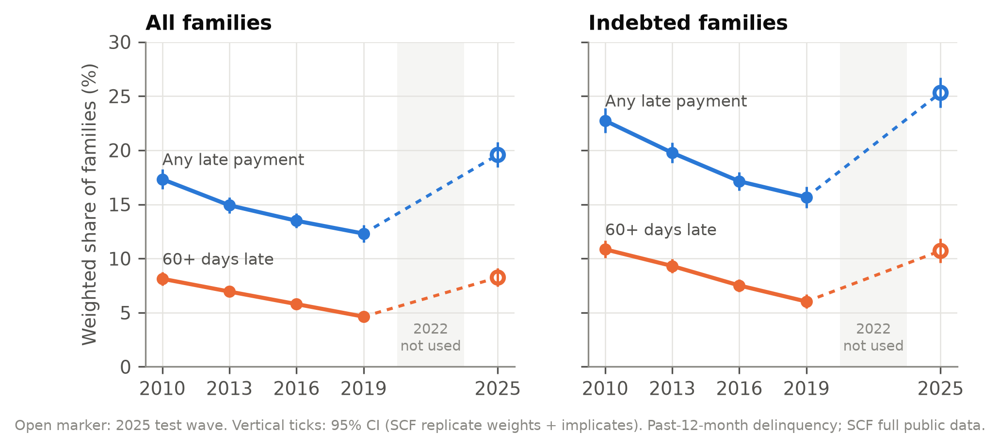
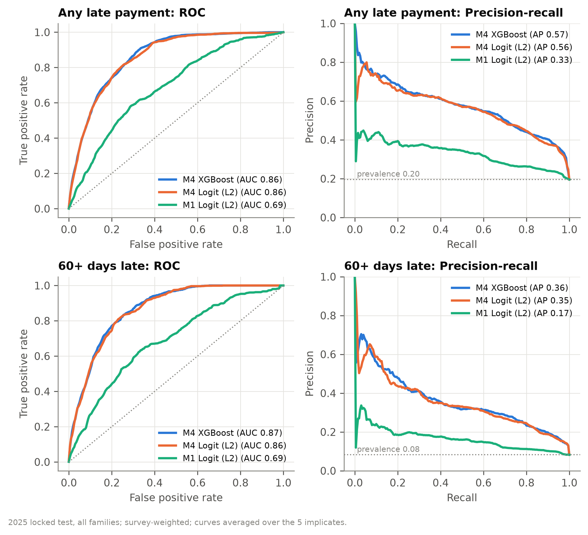
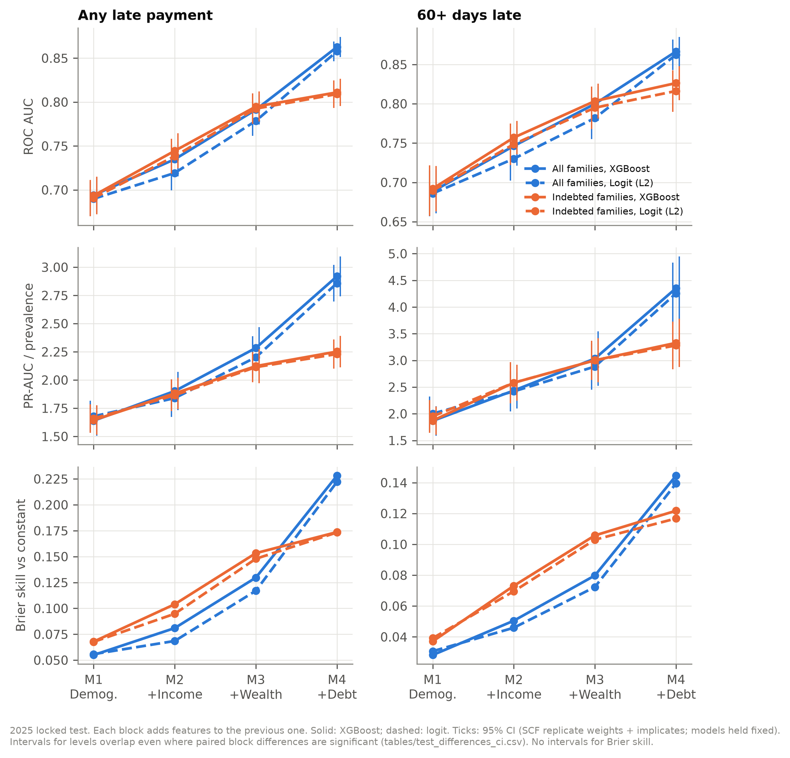
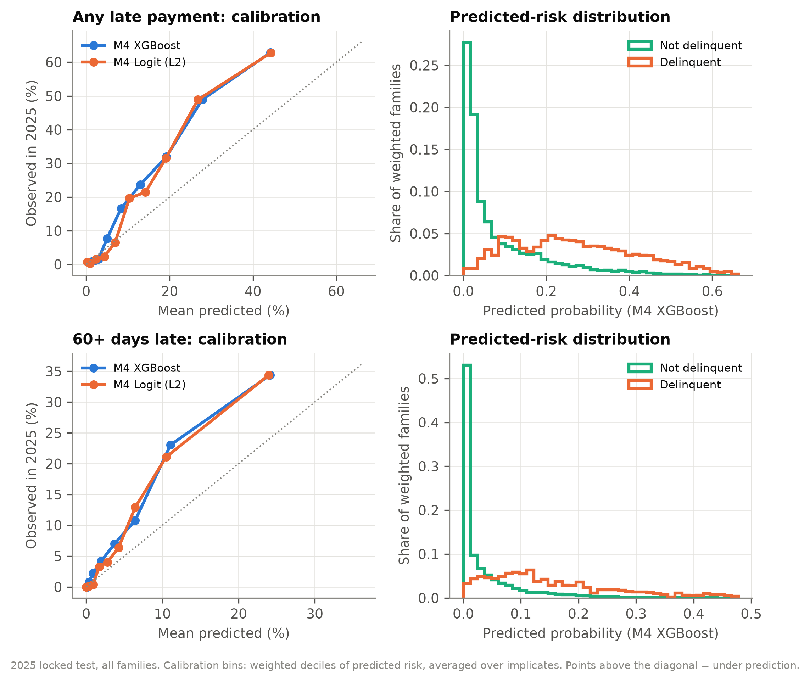
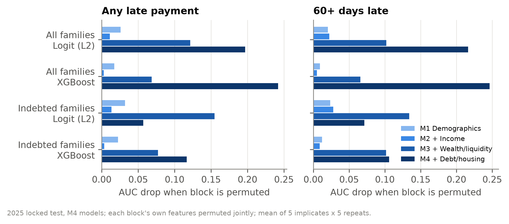
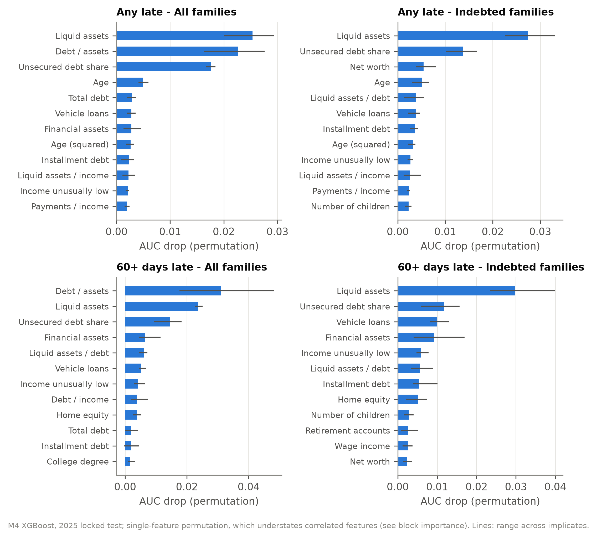
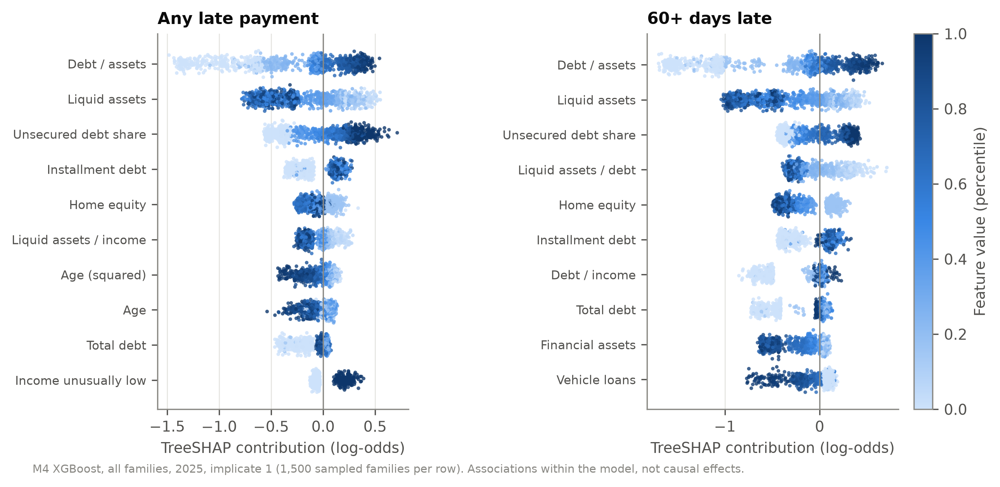
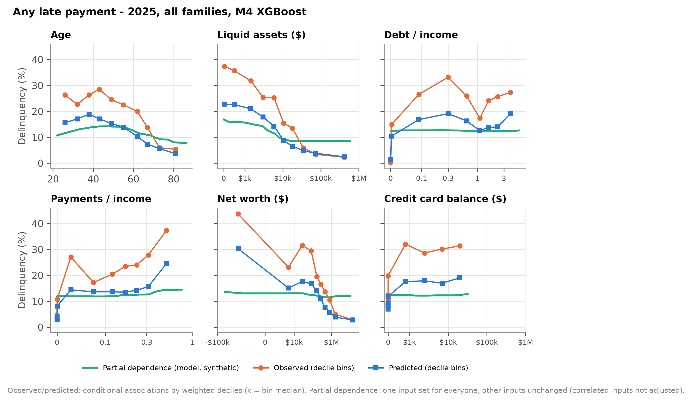
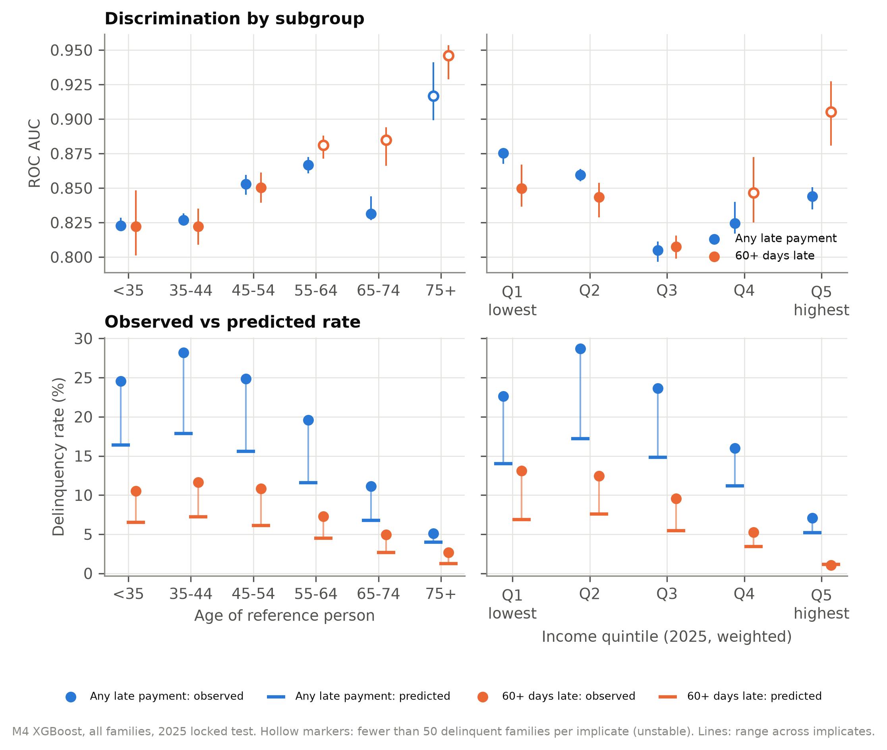

# Classifying Household Delinquency in the Survey of Consumer Finances

Retrospective classification of past-12-month delinquency (`LATE`, `LATE60`) from household balance sheets,
trained on the 2010–2019 SCF waves and tested once on the 2025 wave.

*All numbers below are computed from the full public SCF files by the code in this repository
(`src/scf_distress/`). Run: 8 Nov 2026; config SHA-256 `43da9ac3…`; spec frozen in commit `0284034` before the
2025 wave was scored.*

---

## 1. Summary

- **Financial information carries most of the signal.** On the locked 2025 test (all families), ROC AUC rises
  from 0.69 with demographics only (M1) to 0.72–0.74 with income (M2), 0.78–0.79 with wealth and liquidity (M3),
  and 0.86–0.87 with debt and housing (M4; XGBoost 0.863, 95% CI 0.851–0.874 for any late payment and 0.867,
  0.848–0.885 for 60+ days late). PR-AUC rises from 0.33 to 0.57 for any late payment (prevalence 0.196) and from
  0.17 to 0.36 for 60+ days late (prevalence 0.082). Every block's gain in AUC is statistically significant.
- **Among indebted families, the debt block adds little beyond liquidity and wealth.** M3 → M4 adds about
  0.02 AUC for borrowers (e.g. +0.016, 95% CI 0.008–0.025, for any late payment with XGBoost) versus 0.07–0.08
  for all families. Much of M4's gain in the full population comes from the mechanical fact that families
  without loan payments cannot be late.
- **Liquid assets are the single most informative variable** in almost every model; debt-to-assets and the
  unsecured share of debt follow.
- **Logit and XGBoost perform almost identically.** At M4 their difference is at most 0.01 AUC and not
  statistically significant in any setting; XGBoost is ahead by a small but significant 0.006–0.018 AUC only in
  some reduced models (M2/M3 for all families, M2 for any late payment among borrowers).
- **Ranking transports to 2025; levels do not.** Delinquency fell steadily from 2010 to 2019 and then jumped in
  2025 (any late: 12.3% → 19.6%, about 10 standard errors). Models trained on 2010–2019 rank 2025 families well
  but under-predict their level (calibration-in-the-large +0.36 to +0.71 on the log-odds scale, every 95% CI
  above zero).

Uncertainty: standard errors use the SCF replicate weights and the five implicates (Fed codebook method). For
model metrics they cover sampling and imputation uncertainty of the 2025 evaluation with the fitted models held
fixed; they do not include variability from re-drawing the 2010–2019 training data.

## 2. Data and provenance

| Item | Source |
|---|---|
| Microdata | SCF **full public datasets** `p10i6.dta`, `p13i6.dta`, `p16i6.dta`, `p19i6.dta`, `p25i6.dta` (supplied by the user; checksums in `data/PROVENANCE.json`) |
| Variable definitions | Federal Reserve `bulletin.macro.txt` (SAS), run in Python by `sasport.py` |
| Check only | Fed summary extracts `scfp<year>excel.zip` (downloaded 8 Nov 2026; server date 9 Oct 2026) |
| Standard errors | Fed replicate-weight files `scf<year>rw1s.zip` (999 replicates, implicate 1; downloaded 8 Nov 2026). Replicate totals equal the main-weight household totals in every wave |

The Fed macro was translated mechanically: the year branches are resolved for the public data and the SAS
DATA step is executed vectorized, with SAS missing-value and comparison semantics. **For all five waves, all
350 variables computed in the macro's main DATA step match the Fed summary extract exactly for every
family-implicate** (`tables/macro_validation.csv`). The 10 percentile-category variables computed after the
main step are not ported (not used). Dollar values are in 2025 dollars (CPI-U-RS, macro base 4789). The
summary extracts were used only for this check, never as model inputs.

2022 is excluded from every role by design.

## 3. Labels and estimation samples

- `LATE = (X3004 == 5)`: any loan payment late or missed in the past 12 months.
- `LATE60 = (X3005 == 1)`: any payment 60+ days late in the past 12 months. `X3005` is asked only if `X3004 == 5`.
- `X3004 == 0` means no loan payments were due, so `LATE` is 0 by construction for those families (23–26% of each wave).
- One logical violation was found and fixed: one 2016 family (all 5 implicates) has `X3005 = 1` with `X3004 = 0`;
  its `LATE60` is set to 0 so that `LATE60 ≤ LATE` holds. Other routing oddities (one 2019 family late with
  `X3005` not asked; two 2025 families with `X3005 = 5` and no payments due) do not affect the labels.
- Labels are imputed for some families and can differ across implicates (43–95 families per wave for `LATE`;
  28–57 for `LATE60`, but 143 in 2025); models are fit per implicate, so this is handled naturally.

| Sample | Definition | Role |
|---|---|---|
| A — all families | every SCF family | primary |
| B — indebted | `HDEBT == 1` (debt outstanding at interview) | conditional-risk comparison |
| B2 — payments due | `X3004 != 0` (loan payments due in past year) | robustness (M4 only) |

B is measured at the interview, so families that paid off debt during the year can be `LATE = 1` while not in B;
B2 matches the outcome's routing instead. Each covers 74–77% of families (weighted), and they overlap almost entirely: 97–99% of families in either sample are in both.

## 4. Wave coverage and data audit

| Wave | Families | Records | Households (M) | LATE (A) | LATE60 (A) | LATE (B) | LATE60 (B) |
|---|---|---|---|---|---|---|---|
| 2010 | 6,482 | 32,410 | 117.6 | 17.3% | 8.1% | 22.7% | 10.8% |
| 2013 | 6,015 | 30,075 | 122.5 | 14.9% | 6.9% | 19.8% | 9.3% |
| 2016 | 6,248 | 31,240 | 126.0 | 13.5% | 5.8% | 17.1% | 7.5% |
| 2019 | 5,777 | 28,885 | 128.6 | 12.3% | 4.6% | 15.7% | 6.0% |
| 2025 | 4,360 | 21,800 | 135.0 | **19.6%** | **8.2%** | **25.3%** | **10.7%** |

Survey-weighted means over implicates (`tables/outcome_prevalence.csv`). Standard errors are 0.2–0.7
percentage points, mostly from sampling (`tables/outcome_prevalence_se.csv`). The 2019 → 2025 rise in
any late payment among all families (12.3% ± 0.41 → 19.6% ± 0.59, SEs) is about 10 standard errors. Every family has exactly five implicates. `WGT = X42001/5` sums to about
one-fifth of US households per implicate. Delinquency events per implicate in 2025: 780 (LATE) and 328 (LATE60).



## 5. Predictors

Whitelist only (`features.py`); 46 features in four nested blocks. Dollar amounts use `asinh` (sign kept for
net worth and home equity); constructed ratios use $1,000 denominator floors; Fed payment-to-income ratios keep
the Fed's own income floor. All transforms are fixed functions, so nothing is fit on test data.

| Block | Adds |
|---|---|
| M1 Demographics (11) | age, age², married, number of children, education class (3 dummies), family structure (4 dummies) |
| M2 + Income (18) | income, wage income, normal income, zero income, negative income (raw `X5729` code), income unusually high/low (`X7650`) |
| M3 + Wealth/liquidity (24) | total, financial, liquid and retirement assets; no liquid assets; liquid assets / income |
| M4 + Debt/housing (46) | net worth, negative net worth, has debt, total debt, credit card, mortgage+HELOC, installment, education and vehicle debt, monthly payments, payments/income (total, consumer, revolving), debt/income, debt/assets, liquid assets/debt, unsecured / mortgage / education shares of debt, homeowner, home value, home equity |

`NETWORTH` is in M4, not M3: with total assets in M3 it would reveal total debt (`NETWORTH = ASSET − DEBT`) and
blur the block comparison. Banned from all models: outcome sources (`LATE`, `LATE60`, `X3004`, `X3005`), IDs,
weights, survey year, and realized hardship variables (bankruptcy, foreclosure, payday loans, credit denial,
emergency-response items). Buy-now-pay-later (BNPL) is not a separate feature because it is measured only in 2025.

Because the Fed sets `INCOME = max(0, X5729)` and the public data record negative income only as the codes −1
and −9, negative income cannot be kept as a signed amount; it enters as a flag.

## 6. Estimation design

- **Splits by wave.** Tuning: train 2010–2013 → validate 2016; train 2010–2016 → validate 2019. Final: train
  2010–2019 → **test 2025, scored once**. Leakage checks in `splits.py` and `tests/test_temporal_leakage.py`.
- **Implicates.** Every model is fit separately on each of the five implicates; metrics are reported as mean
  and min–max across implicates. Implicates of a family never cross a split.
- **Weights.** Training: survey weights rescaled so each training wave carries equal total weight. Evaluation:
  survey weights `WGT`. All headline metrics are survey-weighted.
- **Models.** Constant (weighted training prevalence); L2 logistic regression (C ∈ {0.001 … 100}, weighted
  standardization); XGBoost (depth ∈ {2, 3, 4, 6}, learning rate 0.05, early stopping on the validation wave,
  final tree count = mean best iteration). Hyperparameters chosen by mean validation log loss over both folds
  and all implicates. Selected: logit C = 0.01–0.1; XGBoost depth 2–4 with 61–188 trees.
- **Threshold metrics** use the score cutoff that flagged 10% of weighted families in the 2019 validation
  predictions, carried forward unchanged to 2025.
- Run time: 37 seconds for all 36 model settings × 5 implicates (14-core Mac); explanations 33 s.

## 7. Locked 2025 test results

**All families (Sample A), mean over implicates**

| Outcome | Block | Model | AUC | PR-AUC | Brier | Top-10% recall | Lift | CITL |
|---|---|---|---|---|---|---|---|---|
| LATE | — | Constant | 0.500 | 0.196 | 0.160 | 0.10 | 1.0 | 0.36 |
| LATE | M1 | Logit | 0.690 | 0.329 | 0.151 | 0.20 | 2.0 | 0.47 |
| LATE | M2 | XGBoost | 0.735 | 0.372 | 0.147 | 0.23 | 2.3 | 0.54 |
| LATE | M3 | XGBoost | 0.791 | 0.447 | 0.139 | 0.27 | 2.7 | 0.62 |
| LATE | M4 | Logit | 0.858 | 0.560 | 0.124 | 0.32 | 3.2 | 0.61 |
| LATE | M4 | XGBoost | **0.863** | **0.572** | **0.124** | 0.32 | 3.2 | 0.67 |
| LATE60 | — | Constant | 0.500 | 0.082 | 0.076 | 0.10 | 1.0 | 0.28 |
| LATE60 | M1 | Logit | 0.686 | 0.165 | 0.074 | 0.23 | 2.3 | 0.38 |
| LATE60 | M2 | XGBoost | 0.746 | 0.201 | 0.072 | 0.29 | 2.9 | 0.47 |
| LATE60 | M3 | XGBoost | 0.800 | 0.250 | 0.070 | 0.34 | 3.4 | 0.54 |
| LATE60 | M4 | Logit | 0.862 | 0.351 | 0.065 | 0.42 | 4.2 | 0.61 |
| LATE60 | M4 | XGBoost | **0.867** | **0.359** | **0.065** | 0.42 | 4.2 | 0.66 |

**Indebted families (Sample B), M4:** LATE AUC 0.809 (logit) / 0.811 (XGBoost), PR-AUC 0.565 / 0.570
(prevalence 0.253); LATE60 AUC 0.816 / 0.826, PR-AUC 0.351 / 0.357 (prevalence 0.107).

Top-10% recall has a ceiling of 0.51 for LATE (10% / 19.6%), so M4's 0.32 captures about 63% of what a perfect
ranking could.

**95% confidence intervals (replicate weights + implicates), 2025:**

| Outcome | Sample | M1 logit AUC | M4 logit AUC | M4 XGBoost AUC | M4 XGBoost PR-AUC |
|---|---|---|---|---|---|
| LATE | All | 0.690 (0.670–0.709) | 0.858 (0.846–0.869) | 0.863 (0.851–0.874) | 0.572 (0.537–0.606) |
| LATE | Indebted | 0.691 (0.670–0.711) | 0.809 (0.793–0.825) | 0.811 (0.796–0.826) | 0.570 (0.535–0.605) |
| LATE60 | All | 0.686 (0.657–0.715) | 0.862 (0.843–0.882) | 0.867 (0.848–0.885) | 0.359 (0.310–0.408) |
| LATE60 | Indebted | 0.690 (0.657–0.722) | 0.816 (0.790–0.843) | 0.826 (0.805–0.848) | 0.357 (0.308–0.405) |

AUC standard errors are 0.006–0.016, mostly sampling. Full tables: `tables/model_performance.csv`,
`tables/test_metrics_ci.csv`; per implicate: `tables/test_by_implicate.csv`.



## 8. Incremental value of information blocks



- In the full population, each block adds discrimination, and the debt/housing block adds the most
  (AUC +0.07–0.08 for both outcomes).
- Among indebted families, wealth and liquidity (M3) bring most of the gain; adding debt detail (M4) raises AUC
  by only about 0.02 and PR-AUC by 0.03–0.04. Block-permutation importance (below) agrees: for Sample B logit
  models, permuting M3 features costs 0.13–0.16 AUC versus 0.06–0.07 for M4-only features.
- Income alone (M2) adds 0.03–0.06 AUC over demographics.
- **Significance (paired, same replicate weights for both models; `tables/test_differences_ci.csv`).** Every
  step M1→M2, M2→M3, M3→M4 improves AUC and Brier score significantly in both samples and both outcomes, with
  one partial exception: for 60+ days late among borrowers, M3→M4 improves AUC significantly (+0.021 logit,
  +0.023 XGBoost), but the PR-AUC gain (+0.03) and, for the logit, the Brier gain have 95% CIs that include zero. Confidence intervals for the
  levels in the figure overlap more than these paired comparisons suggest, because both models are scored on
  the same families.

## 9. Calibration and the 2025 shift



Every model under-predicts 2025 delinquency: calibration-in-the-large (CITL) is +0.36 to +0.71 on the log-odds
scale (e.g. M4 XGBoost, any late: +0.67, 95% CI 0.60–0.75; every interval excludes zero), and in the riskiest decile observed rates are about 63% (LATE) versus 44% predicted. In the backtests
the sign was reversed (CITL −0.05 to −0.40, over-prediction), because delinquency was falling through 2019.
Survey year is deliberately not a predictor, so a model trained on 2010–2019 cannot anticipate the reversal.
Calibration slopes are 0.96–1.27 (predicted risks somewhat too compressed for LATE). **Predicted probabilities
should not be read as 2025 levels without recalibration;** rankings are much more stable.

2025 discrimination is higher than in the backtests (e.g. LATE M4 AUC 0.86 in 2025 versus 0.81–0.82 when
predicting 2016 and 2019), already for demographics alone (0.69 vs 0.66–0.68). That points to a wider spread of
risk in 2025 rather than to a modelling artefact. The 2025-only inclusion of BNPL in Fed debt totals is not the
explanation (§12).

## 10. Feature interpretation







- **Liquid assets** rank first or second by single-feature permutation in every M4 XGBoost model (AUC drop
  0.024–0.030) and first among borrowers. Low liquidity goes with higher predicted delinquency.
- **Debt-to-assets** and the **unsecured share of debt** come next in the full population. Debt-to-assets also
  encodes having any debt (it is 0 without debt), which is why it dominates in Sample A; in the logit, the
  `has debt` indicator itself carries that role.
- **Income unusually low**, age (higher age → lower risk), vehicle and installment debt, and home equity
  contribute smaller amounts.
- Single-feature permutation understates groups of correlated variables (debt totals, ratios and shares move
  together), so block-level importance is the more reliable summary.



The response figures separate two things: observed and predicted rates by weighted deciles of each variable
(*conditional associations* in 2025), and partial dependence (*synthetic*: one input changed for everyone,
others held at observed values, correlated inputs not adjusted). Observed delinquency falls steeply with liquid
assets and net worth and with age after 45. The partial-dependence curves are flat for debt-to-income and credit
card balances once liquidity and debt structure are held fixed: these variables matter jointly, not
individually. `figures/fig7_response_late60_2025.png` shows the same for LATE60. None of these are causal effects.

## 11. Subgroups (2025, M4 XGBoost, all families)



- Discrimination is good in every age and income group (AUC 0.80–0.95). Cells with fewer than 50 delinquent
  families per implicate are flagged as unstable (hollow markers): ages 75+, and for LATE60 ages 55+ and income
  quintiles 4–5.
- Under-prediction is concentrated where delinquency is common: ages under 55 and the bottom three income
  quintiles (observed 23–29% versus predicted 14–18% for LATE). Predictions are closest to observed rates in the
  top income quintile (LATE 7.1% observed versus 5.2% predicted; LATE60 1.1% versus 1.1%).
- Income quintiles are weighted quintiles of 2025 income within each sample; full table:
  `tables/subgroup_performance.csv`.

## 12. Robustness

| Check | Result |
|---|---|
| Backtests (validation waves 2016, 2019; selected hyperparameters, so mildly optimistic) | Same block ordering; M4 AUC 0.81–0.82 (LATE) and 0.86 (LATE60) in Sample A |
| Payments-due sample B2 instead of HDEBT | M4 AUC 0.804 / 0.808 (LATE), 0.820 / 0.829 (LATE60), close to Sample B |
| Remove BNPL from 2025 debt and payment totals (models unchanged) | AUC changes by +0.001 to +0.004; CITL unchanged in sign and size. BNPL is not behind the higher 2025 AUC |
| Logit vs XGBoost | ≤ 0.02 AUC apart everywhere; at M4 no difference is significant (largest: +0.010 AUC, 95% CI −0.006 to +0.026, LATE60 borrowers) |

BNPL context: 12.5% of 2025 families (weighted) report a BNPL balance; 42.5% of them had a late payment,
versus 16.7% of other families. BNPL is a strong correlate of delinquency in 2025, but it cannot be used in
models trained on earlier waves.

## 13. Retrospective classification, not prospective prediction

Labels refer to the **12 months before the interview**; predictors are measured **at the interview**. Low
liquid assets, high unsecured balances or negative net worth may be consequences of the same hardship that
produced late payments, not leading indicators. These models therefore *classify* households with recent
delinquency from a contemporaneous balance sheet. They are not estimates of next year's default risk, not
credit scores, and not causal effects of any variable. The 2025 test asks whether relationships estimated on
earlier cross-sections transport to a new cross-section; it does not follow the same households over time.

## 14. Caveats, gaps and failures

- **Uncertainty.** Design-based standard errors (replicate weights + implicates) cover prevalence and all 2025
  test metrics and paired model differences. For model metrics they hold the fitted models fixed, so they
  measure uncertainty in the 2025 evaluation, not variability from the training sample; true uncertainty about
  model performance is somewhat larger. Validation (backtest) metrics have no intervals. Subgroup results
  report implicate ranges only.
- **Not run yet** (from the proposal): the raw-population-weight sensitivity (`weights.sensitivity_scheme: raw`
  is configured but unused), the modern-waves-only robustness (train 2016/2019 → test 2025), post-hoc
  recalibration fitted on historical held-out data, and the expanded model with behavioural variables (`SAVED`,
  `YESFINRISK`, `FINLIT`).
- **Threshold metrics** take the cutoff from the 2019 validation predictions of the tuning-fold model (trained
  on 2010–2016), not from the final model; for M4 models the cutoff flagged 9–10% of 2025 families as intended
  (6–8% for M1 models).
- **Sample B** uses debt at interview; B2 (payments due in the past year) gives similar results.
- **Oversampling.** The SCF oversamples wealthy families, so unweighted counts are concentrated at the top of
  the distribution (e.g. 1,522 families in the top income quintile versus about 700 in the others).
- **Bugs found and fixed during the work:** an int16 overflow in the implicate ID (`10*yy1`) that briefly
  produced fake implicates in an early audit; the SAS `CALL=` assignment (call accounts) wrongly skipped as a
  `CALL` routine, caught by the extract comparison; the first full model run crashed in two seconds, before any
  results were written, on an undefined calibration slope for the constant model. Event counts quoted in early
  notes were affected by the first bug; all numbers in this report are from the corrected code.

## 15. Reproduce

```bash
python3 -m venv .venv && .venv/bin/python -m pip install -e '.[ml,explain,dev]' pyarrow
.venv/bin/python -m scf_distress.pipeline --config config.yaml --build
.venv/bin/python -m scf_distress.pipeline --config config.yaml --run --explain --variance --figures
.venv/bin/python -m pytest -q
```

Versions: Python 3.12.2, numpy 2.5.4, pandas 3.1.1, scikit-learn 1.9.1, xgboost 3.4.1; seed 20261108
(`run_metadata.json`).
